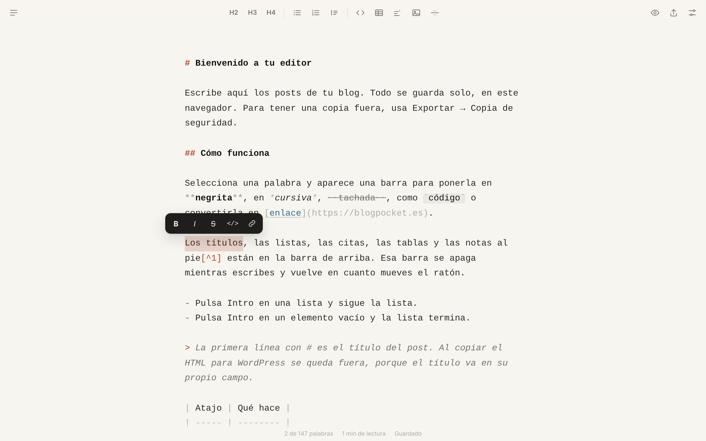

# Editor Blogpocket

Editor de Markdown minimalista para escribir los posts de tu blog. Lo instalas en tu propio hosting, funciona sin conexión y no depende de ningún servicio externo.

**[Prueba la demo](https://blogpocket.github.io/editor-blogpocket/)** · Versión 1.1.0 · Licencia MIT

Te cuento cómo nació y cómo instalarlo en [Blogpocket](https://blogpocket.es/articulo/editor-markdown-blogpocket/).



## Qué hace

Escribes en texto plano o en Markdown. Ves la sintaxis (`**`, `##`, `>`), pero con estilo: los títulos en negrita, los símbolos en gris, los enlaces subrayados. Así el texto que guardas y copias es Markdown limpio, sin sorpresas.

- **Barra flotante.** Seleccionas texto y aparecen negrita, cursiva, tachado, código y enlace. Si pegas una URL sobre una palabra seleccionada, la conviertes en enlace.
- **Barra superior.** Títulos H2, H3 y H4, listas, listas numeradas, citas, bloques de código, tablas, notas al pie, imágenes y separadores. Se apaga mientras escribes y vuelve cuando mueves el ratón.
- **Listas cómodas.** Intro continúa la lista, Intro en un elemento vacío la cierra y Tab sangra.
- **Tablas.** Tab salta de celda en celda. Con el cursor dentro de una tabla, el botón de tabla alinea las columnas. Si pegas filas desde una hoja de cálculo, las seleccionas y el mismo botón las convierte en tabla.
- **Notas al pie.** El editor las numera y te lleva al final para escribirlas. Esc te devuelve al punto donde estabas.
- **Borradores.** Tantos como quieras, con buscador. El editor guarda cada pocos segundos.
- **Vista previa** del post tal como quedará.
- **Exportar.** Copias Markdown o HTML, descargas `.md` o `.html` y abres archivos `.md`.
- **Copia de seguridad.** Descargas todos tus borradores en un `.json` y los restauras en otro navegador o dispositivo.
- **Ajustes.** Tema claro u oscuro, letra Mono, Sans o Serif, tres tamaños, tres anchos y un modo enfoque que atenúa todo menos el párrafo que escribes.
- **App instalable** en el ordenador y en el móvil, también sin conexión.

## Pensado para WordPress

La primera línea que empieza por `#` cuenta como título del post. «Copiar HTML» la deja fuera, porque en WordPress el título va en su propio campo.

«Copiar HTML» copia en formato enriquecido. Al pegarlo en el editor de bloques, WordPress crea bloques de verdad: párrafos, títulos, listas, tablas, imágenes.

## Instalación en un hosting con cPanel

1. Descarga el repositorio (botón **Code → Download ZIP**).
2. En el Administrador de archivos de cPanel, entra en la carpeta pública de tu dominio, por ejemplo `public_html/tudominio.com/`.
3. Sube el ZIP, extráelo y renombra la carpeta a `editor`. Activa «Mostrar archivos ocultos» para comprobar que el `.htaccess` está dentro.
4. Abre `https://tudominio.com/editor/`.

Si tu web es un WordPress, no hace falta tocar nada más: Apache sirve la carpeta real antes de pasarle la petición a WordPress.

Puedes usar cualquier nombre de carpeta. El editor usa rutas relativas.

### Protégelo con contraseña

Tus textos viven en tu navegador, así que nadie más puede leerlos. Aun así, conviene que solo tú puedas abrir el editor.

**Con cPanel:** abre **Privacidad de directorios** (Directory Privacy), entra en la carpeta `editor`, marca «Proteger este directorio con contraseña» y crea tu usuario. cPanel añade al `.htaccess` las líneas necesarias.

**A mano:** abre el Terminal de cPanel y crea el archivo de contraseñas fuera de `public_html`:

```bash
mkdir -p ~/.htpasswds/editor
htpasswd -c ~/.htpasswds/editor/passwd tu_usuario
```

Después descomenta las cuatro líneas del principio del `.htaccess` y cambia `TU_USUARIO` por tu usuario de cPanel en la ruta.

### En otros servidores

Sirve para cualquier hosting que entregue archivos estáticos por HTTPS. El `.htaccess` (cabeceras de seguridad, caché y contraseña) solo funciona en Apache y LiteSpeed. En Nginx tendrás que trasladar esas reglas a tu configuración.

## Instálalo como app

- **Chrome o Edge:** icono de instalar en la barra de direcciones.
- **Safari en Mac:** Archivo → Añadir al Dock.
- **iPhone y iPad:** Compartir → Añadir a pantalla de inicio.
- **Android:** menú ⋮ → Instalar aplicación.

## Dónde se guardan tus textos

En el almacenamiento de tu navegador (IndexedDB). Tenlo en cuenta:

- Cada navegador y cada dispositivo tiene sus propios borradores. Lo que escribes en el ordenador no aparece en el móvil.
- Si borras los datos del sitio en el navegador, pierdes los borradores.
- El editor no envía nada a ningún servidor.

Para guardar tus textos fuera del navegador, usa **Exportar → Copia de seguridad** de vez en cuando. Para pasarlos a otro dispositivo, abre allí el editor y usa **Exportar → Restaurar copia**. Si un borrador existe en los dos sitios, el editor conserva la versión más reciente.

## Atajos de teclado

En Windows y Linux, cambia ⌘ por Ctrl. Los títulos usan Ctrl + Mayús + número.

| Acción | Atajo |
| --- | --- |
| Negrita / Cursiva | ⌘ B / ⌘ I |
| Enlace | ⌘ K |
| Código en línea | ⌘ E |
| Tachado | ⌘ Mayús X |
| Título 2 / 3 / 4 | ⌘ ⌥ 2 / 3 / 4 |
| Lista / Lista numerada | ⌘ Mayús 8 / ⌘ Mayús 7 |
| Cita | ⌘ Mayús . |
| Vista previa | ⌘ Mayús P |
| Borradores | ⌘ Mayús O |
| Nuevo borrador | ⌘ ⌥ N |
| Guardar ya | ⌘ S |
| Volver de una nota al pie | Esc |

## Actualizar a una versión nueva

Sustituye los archivos de la carpeta y conserva tu `.htaccess` si cPanel le añadió la contraseña. La app carga la versión nueva en la siguiente visita. Tus borradores siguen en el navegador.

Si cambias el código tú, sube el número de `CACHE` en `sw.js` para que los navegadores descarguen los archivos nuevos.

## Demo en GitHub Pages

Si haces un fork y quieres tu propia demo: Settings → Pages → Deploy from a branch → `main` y `/ (root)`. GitHub Pages ignora el `.htaccess`, así que la demo queda abierta. No pasa nada: cada visitante escribe en su propio navegador.

## Archivos

| Archivo | Para qué sirve |
| --- | --- |
| `index.html` | Estructura de la página |
| `styles.css` | Diseño y temas claro y oscuro |
| `app.js` | Toda la lógica del editor |
| `sw.js` | Modo sin conexión |
| `manifest.json` | Datos de la app instalable |
| `icons/` | Iconos de la app |
| `vendor/` | Librerías de terceros, sin CDN |
| `.htaccess` | Seguridad, caché y contraseña |

Sin compilación ni dependencias que instalar. Editas un archivo, lo subes y listo.

## Créditos

Hecho por [Antonio Cambronero](https://blogpocket.es) con la ayuda de Claude, de Anthropic.

Usa estas librerías, incluidas en `vendor/` con sus licencias en `vendor/licenses/`:

- [marked](https://github.com/markedjs/marked) 18.1.1 (MIT), para convertir Markdown en HTML.
- [marked-footnote](https://github.com/bent10/marked-extensions) 1.4.0 (MIT), para las notas al pie.
- [DOMPurify](https://github.com/cure53/DOMPurify) 3.4.17 (Apache 2.0 o MPL 2.0), para limpiar el HTML de la vista previa.

## Soporte

Es un proyecto personal que comparto tal cual. Si encuentras un fallo, abre una *issue* y le echaré un vistazo cuando pueda, sin plazos ni compromisos.

## Licencia

[MIT](LICENSE). Puedes usarlo, modificarlo y redistribuirlo, también en proyectos comerciales, siempre que conserves el aviso de copyright.
